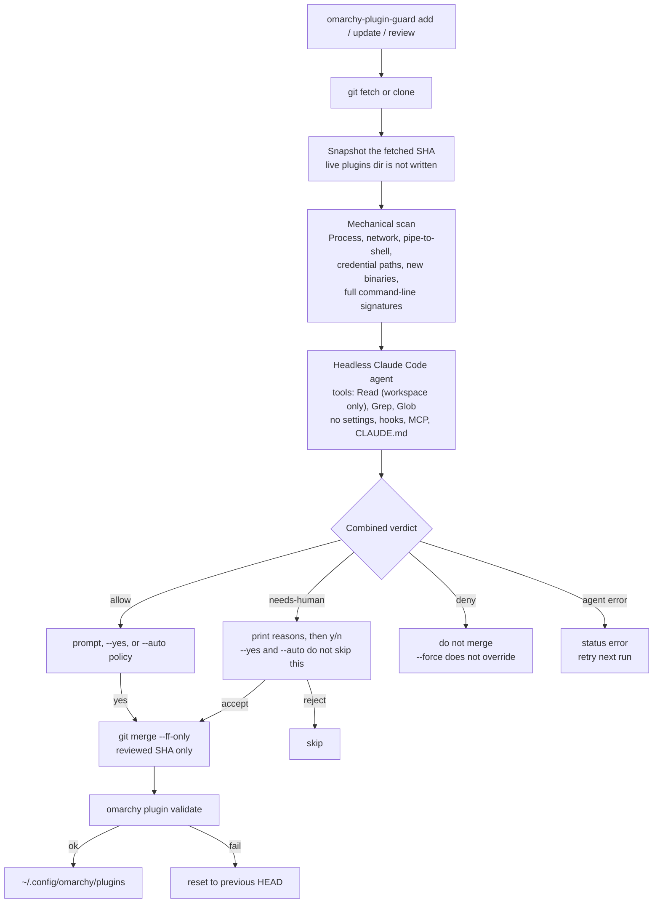

# omarchy-plugin-guard



Omarchy shell plugins are unsandboxed QML inside the long-lived `omarchy-shell` process. `omarchy plugin validate` only checks the manifest. This CLI reviews the **incoming git commit** and merges **that SHA only** — it never fetches again after the review.

This is a command-line tool, not an Omarchy bar plugin. Install it with pip, then use it instead of `omarchy plugin add` / `omarchy plugin update`. A systemd user timer can run the review daily and tell you what is waiting.

## How it works

1. **Fetch** — `git fetch` only, into `refs/omarchy-plugin-guard/incoming`. `FETCH_HEAD` is neither read nor written: `omarchy plugin update` and plugins such as omaplug fetch into the same checkouts from inside omarchy-shell, and git leaves `FETCH_HEAD` empty while a fetch is in flight. The live tree under `~/.config/omarchy/plugins` stays untouched.
2. **Scan** — snapshot that commit and look for Process/exec, network, credential paths, pipe-to-shell, new binaries. Every `command: [...]` array gets a signature, so a changed string inside an existing `bash -c` counts as a capability expansion even when the first token did not change. Compare to the previous commit and the stored baseline.
3. **Agent** — a headless Claude Code session (`claude -p`) reads the diff and the snapshot with Read, Grep and Glob only. It runs with no settings, hooks, MCP servers, CLAUDE.md or auto-memory from your machine, a replaced system prompt, and Read scoped to the review workspace. Files such as `CLAUDE.md` or `.claude/` inside the plugin are renamed `UNTRUSTED_*` before the agent sees them. The verdict comes back as schema-validated JSON. If the agent tried a denied tool call, the update needs a human.
4. **Verdict** — four outcomes:
   - **ALLOW** — clean delta, agent agreed, no new capabilities. Confirm, `--yes`, or the `--auto` policy.
   - **NEEDS HUMAN** — new Process/network/binary, a changed command line, first install, truncated diff, denied agent tool calls, or the agent is unsure. Prints **NEEDS HUMAN REVIEW** and the reasons, then asks accept or deny. `--yes` and `--auto` will not skip this; `--force` will.
   - **DENY** — pipe-to-shell, credential-path hits, or agent deny. Prints **DENIED — will not apply**. Never merges. `--force` does not override.
   - **ERROR** — the agent could not run (not logged in, timeout, outage). Nothing is applied and nothing is recorded as a judgement; the next run retries.
5. **Merge** — fast-forward the reviewed SHA, then `omarchy plugin validate`. A later commit that landed on GitHub during the review is not pulled in.

Every outcome is appended to `~/.config/omarchy/plugin-guard/audit.jsonl`.

## Install

```bash
git clone https://github.com/yelenkovsky/omarchy-plugin-guard.git
cd omarchy-plugin-guard
python3 -m venv .venv
.venv/bin/pip install -e .
ln -sf "$PWD/.venv/bin/omarchy-plugin-guard" ~/.local/bin/omarchy-plugin-guard
```

Requires Python 3.11+ and [Claude Code](https://claude.com/claude-code) on `PATH`, logged in (`claude auth status`). No API key is handled by this tool; the agent uses whatever `claude` is logged in with. No Python dependencies.

Mechanical scan still runs with `--skip-agent` (that path always ends **needs-human**, never auto-applies).

## First run

Record what is already installed, then stop using raw `omarchy plugin update`:

```bash
omarchy-plugin-guard baseline --write
omarchy-plugin-guard status
omarchy-plugin-guard review
omarchy-plugin-guard update
omarchy-plugin-guard add https://github.com/example/omarchy-weather.git --enable
```

`--yes` auto-confirms **allow** only. `--force` also applies **needs-human**. Nothing applies a **deny**.

**Upgrading from 0.1:** run `baseline --write` once. Older baselines have no command signatures, and until they are refreshed every update to a plugin that runs commands is reported as needs-human with the reason `baseline:no command signatures recorded`.

## Daily timer

The shipped units fetch, review and send a desktop notification once a day. Nothing merges; you run `update --yes` when you sit down and the review is already done.

```bash
cp systemd/omarchy-plugin-guard.service systemd/omarchy-plugin-guard.timer ~/.config/systemd/user/
systemctl --user daemon-reload
systemctl --user enable --now omarchy-plugin-guard.timer
systemctl --user list-timers omarchy-plugin-guard.timer
```

Logs: `journalctl --user -u omarchy-plugin-guard.service`.

## Unattended auto-apply

`update --auto` merges an **allow** verdict without a prompt only when every gate passes:

- the diff was not truncated and has at most 400 changed lines (`--max-diff-lines`),
- the plugin, before and after, is declarative QML: no Process, network, helper scripts, native code or privilege use,
- the incoming SHA was first fetched by this machine at least 3 days ago (`--soak-days`), so an upstream compromise has time to be noticed and reverted. The clock is local; commit timestamps are not trusted.

Anything else is reported as `deferred` with the gate that failed, or as `needs-human`, and waits for you. `--auto` cannot be combined with `--force`.

To switch the timer to auto mode after you have watched a few weeks of verdicts:

```bash
printf 'OMARCHY_PLUGIN_GUARD_ARGS="update --auto --notify"\n' > ~/.config/omarchy/plugin-guard/timer.env
```

Delete that file to return to review-only.

## Commands

```text
omarchy-plugin-guard status
omarchy-plugin-guard baseline --write
omarchy-plugin-guard review [--json] [--notify] [--model m]
omarchy-plugin-guard update [id] [--dry-run] [--yes] [--force] [--auto] [--soak-days n] [--max-diff-lines n] [--skip-agent] [--notify] [--json]
omarchy-plugin-guard add <git-url> [--enable] [--dry-run] [--force]
```

Exit codes: `0` ok / up to date / applied / deferred, `1` hard error or agent error, `2` denied or skipped.

Environment:

| Variable | Default | Meaning |
|---|---|---|
| `OMARCHY_PLUGIN_GUARD_MODEL` | `sonnet` | Claude model alias or id for the review |
| `OMARCHY_PLUGIN_GUARD_CLAUDE` | `claude` | Path to the Claude Code binary |
| `OMARCHY_PLUGIN_GUARD_MAX_TURNS` | `24` | Agent turn cap |
| `OMARCHY_PLUGIN_GUARD_AGENT_TIMEOUT` | `600` | Seconds before an agent run is abandoned |
| `OMARCHY_PLUGIN_GUARD_SOAK_DAYS` | `3` | Auto-apply soak delay |
| `OMARCHY_PLUGIN_GUARD_MAX_DIFF_LINES` | `400` | Auto-apply diff cap |

State: `~/.config/omarchy/plugin-guard/` (`baselines/`, `reviews/` latest per plugin, `seen/` first-seen SHAs, `audit.jsonl`, `lock`, `workspace/` while a review runs). Only one `review`, `update`, `add` or `baseline` runs at a time.

## License

[MIT](LICENSE). You may use, copy, modify, and distribute this without asking.
